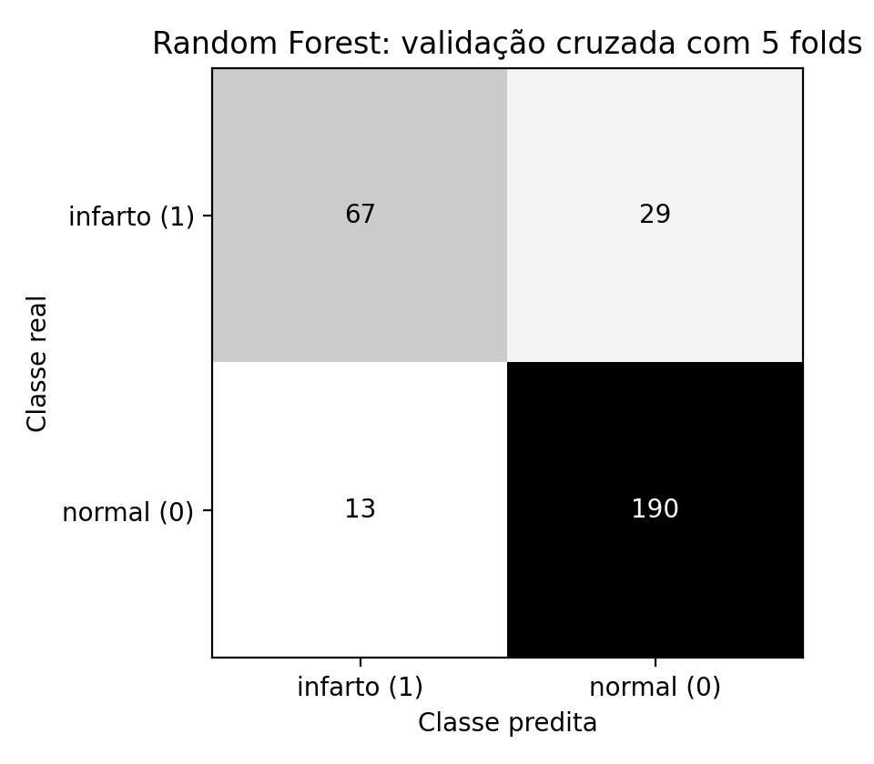
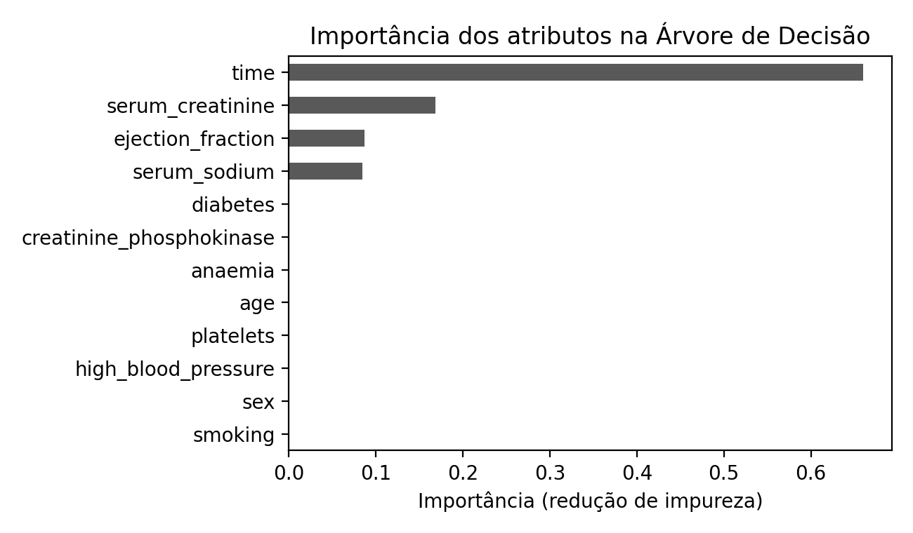
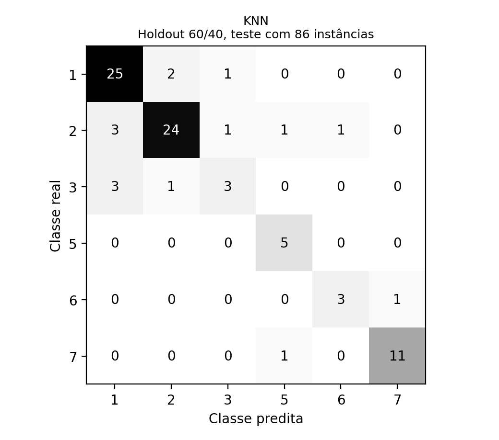

# Classificadores clássicos: validação cruzada e holdout

Comparação sistemática de classificadores do scikit-learn em dois problemas de saúde e de materiais, com protocolos de avaliação diferentes e busca de hiperparâmetros feita sem tocar nos dados de teste.

Atividades da disciplina **Aprendizagem de Máquina** da Especialização em Inteligência Artificial e Ciência de Dados da PUCPR (Prof. Alceu de Souza Britto Jr.).

| Pasta | Problema | Protocolo | Modelos |
|---|---|---|---|
| [`01-heart-failure-validacao-cruzada`](01-heart-failure-validacao-cruzada) | prever óbito de pacientes com insuficiência cardíaca (299 pacientes, 12 atributos clínicos) | validação cruzada estratificada de 5 folds | KNN, Árvore de Decisão, Naive Bayes, MLP, SVM, Bagging, Random Forest, AdaBoost, Gradient Boosting, Voting |
| [`02-glass-holdout`](02-glass-holdout) | identificar o tipo de vidro pela composição química (214 amostras, 6 classes) | holdout estratificado 60/40 | monolíticos contra ensembles homogêneos e heterogêneos |

## 1. Heart Failure: validação cruzada

A classe positiva (`DEATH_EVENT`, óbito durante o acompanhamento, chamada de "infarto" no enunciado da atividade) é minoritária (32%), então a métrica principal é o **F1 dessa classe**, e não a acurácia. Os hiperparâmetros de cada modelo são escolhidos com `GridSearchCV` otimizando o F1, e as métricas vêm das previsões fora do fold (`cross_val_predict`). Os modelos sensíveis a escala (KNN, MLP, SVM) recebem `StandardScaler` dentro de um `Pipeline`, de modo que a padronização é ajustada só no treino de cada fold.

| Modelo | Tipo | Acurácia | F1 (óbito) |
|---|---|---|---|
| **Random Forest** | caixa-preta | **85,95%** | **0,761** |
| Gradient Boosting | caixa-preta | 84,28% | 0,749 |
| AdaBoost | caixa-preta | 83,95% | 0,727 |
| **Árvore de Decisão** | caixa-branca | 82,27% | 0,725 |
| Bagging | caixa-preta | 82,61% | 0,720 |
| SVM | caixa-preta | 80,27% | 0,720 |
| MLP | caixa-preta | 80,94% | 0,702 |
| Voting (RF + SVM + KNN) | caixa-preta | 81,94% | 0,679 |
| Naive Bayes | caixa-branca | 79,93% | 0,620 |
| KNN | caixa-preta | 74,58% | 0,537 |

A árvore de decisão, interpretável, fica a apenas 0,04 de F1 do melhor modelo. O atributo mais importante é `time` (tempo de acompanhamento), seguido de `serum_creatinine` e `ejection_fraction`; ele também é a raiz da árvore.

<p>


</p>

## 2. Glass: holdout 60/40

Base pequena e desbalanceada (a menor classe tem 9 amostras). Os hiperparâmetros de cada modelo foram escolhidos por validação cruzada **dentro dos 60% de treino**; os 40% de teste foram usados uma única vez.

| Grupo | Modelo | Acurácia no teste |
|---|---|---|
| Monolítico | **KNN (1-NN, Manhattan, padronizado)** | **82,56%** |
| Ensemble | Bagging de árvores | 81,40% |
| Ensemble | Random Forest | 80,23% |
| Ensemble | Voto suave (DT + KNN + SVM + MLP) | 79,07% |
| Ensemble | AdaBoost | 79,07% |
| Monolítico | KNN ponderado | 75,58% |
| Ensemble | Voto majoritário (DT + KNN + SVM + MLP) | 72,09% |
| Monolítico | MLP | 69,77% |
| Monolítico | SVM | 63,95% |
| Monolítico | Árvore de Decisão | 61,63% |
| Monolítico | Naive Bayes | 51,16% |

O resultado contraria a intuição de que ensembles sempre vencem: com poucas amostras e classes bem localizadas no espaço de atributos, o vizinho mais próximo é difícil de bater. Os ensembles, por outro lado, são bem mais estáveis que os seus membros isolados (a árvore sozinha fica em 61,63%; o bagging de árvores, em 81,40%).



## Estrutura

Cada pasta tem o script, a base, as figuras geradas, a saída completa do script (`saida_*.txt`), a tabela de resultados (`resultados_*.csv`) e o relatório entregue (`relatorio.pdf`).

## Como executar

```bash
pip install -r requirements.txt
cd 01-heart-failure-validacao-cruzada && python atividade2_validacao_cruzada.py
cd ../02-glass-holdout && python atividade3_holdout.py
```

Todas as sementes estão fixadas em 42. Versões diferentes do scikit-learn podem mudar levemente o resultado de modelos com aleatoriedade interna, como o Random Forest.

## Dados

* **Heart Failure Clinical Records**: Chicco e Jurman (2020), [UCI Machine Learning Repository](https://archive.ics.uci.edu/dataset/519/heart+failure+clinical+records), CC BY 4.0.
* **Glass Identification**: German (1987), [UCI Machine Learning Repository](https://archive.ics.uci.edu/dataset/42/glass+identification), CC BY 4.0. O script tenta baixar a base do UCI e usa a cópia local `glass.data` se não houver internet.

## Tecnologias

Python, scikit-learn, pandas, NumPy, Matplotlib.

## Autor

**César Willian Pacheco**
